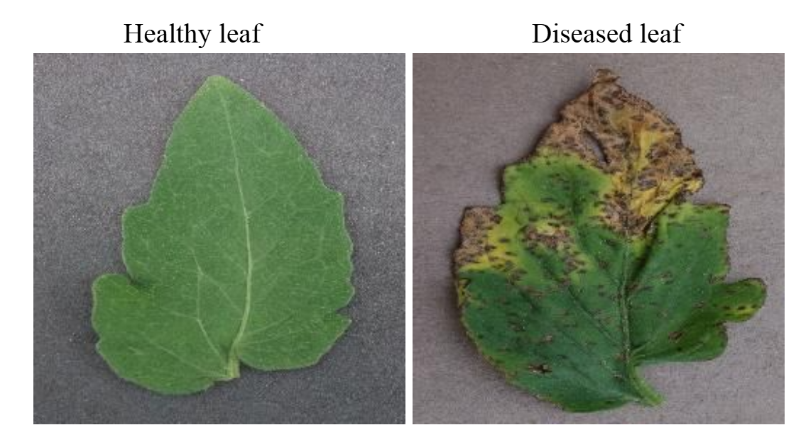
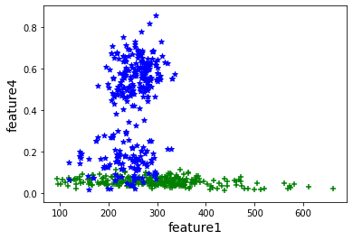
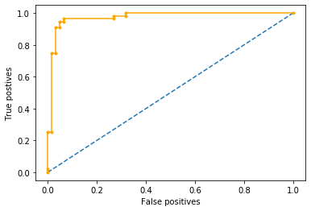

# Predicting Crop Diseases using Machine Learning

Classify plant leaf images as **healthy** or **diseased** using hand-crafted image features (colour, shape, texture) and a **Support Vector Machine (SVM)**.

Each image is reduced to four numbers using OpenCV and scikit-image. A linear SVM trained on those numbers separates healthy from diseased leaves with **over 90% accuracy** on a held-out test split.

<p align="center">
  

   
</p>

---

## Why this project

Cash crops are prone to diseases caused by pests and microbes, and farmers often respond by spraying pesticides heavily, which harms human health and the environment. Many diseases show up first as visible pigmentation and spots on the leaves. Detecting these early from a photo could limit an outbreak and cut unnecessary chemical use.

## How it works

```
Leaf image ──► Preprocessing ──► Segmentation ──► Feature extraction ──► Linear SVM ──► Healthy / Diseased
               (BGR → HSV,       (green mask,      (4 features per
                grayscale, blur)  Otsu threshold)   image → CSV)
```

| # | Feature | How it is computed |
|---|---------|--------------------|
| 1 | Green region | Pixels inside the HSV green range `(30,0,0)`–`(70,255,255)` |
| 2 | Non-green region | `1 − feature 1` |
| 3 | Leaf perimeter | Total contour length after Gaussian blur + Otsu threshold, ÷ 150 |
| 4 | Texture contrast | Sum of GLCM contrast over distances {1, 2} and angles {0, π/2, 3π/4}, ÷ 20 000 |

See [docs/methodology.md](docs/methodology.md) for the full explanation.

## Results

| Run | Test samples | Accuracy | Confusion matrix |
|-----|-------------:|---------:|------------------|
| Saved notebook output | 119 | **94.1%** | `[[54, 2], [5, 58]]` |
| Project report (PDF) | 119 | **96.6%** | `[[62, 0], [4, 53]]` |

The two runs differ because `train_test_split` is called without a fixed `random_state`. Details are in [docs/results.md](docs/results.md).

## Repository contents

| Path | Description |
|------|-------------|
| [`MT19211_MT19214.ipynb`](MT19211_MT19214.ipynb) | Jupyter notebook: feature extraction, SVM training, evaluation, ROC curve |
| [`Plant_disease_analysis.pdf`](Plant_disease_analysis.pdf) | Project report (motivation, workflow, results, conclusions) |
| `training-20191201T155348Z-001.zip` | Dataset: 593 leaf images (327 healthy, 266 diseased) plus the pre-computed `training.csv` |
| [`docs/`](docs/) | Detailed documentation |
| [`requirements.txt`](requirements.txt) | Python dependencies |

## Quick start

```bash
git clone https://github.com/Debashish-Mohanta/Predicting-of-Crop-Diseases-using-machine-learning.git
cd Predicting-of-Crop-Diseases-using-machine-learning

python -m venv .venv
# Windows: .venv\Scripts\activate    macOS/Linux: source .venv/bin/activate
pip install -r requirements.txt

# Extract the dataset (creates ./training/)
python -m zipfile -e training-20191201T155348Z-001.zip .

jupyter notebook MT19211_MT19214.ipynb
```

> **Important:** the notebook has hard-coded Windows paths (`E://Mtech programs/...`). Change them to your local `training/` folder before running. [docs/usage.md](docs/usage.md) gives step-by-step instructions, including how to skip feature extraction and use the provided CSV.

## Documentation

- [Methodology](docs/methodology.md): the pipeline, each feature, and the classifier
- [Dataset](docs/dataset.md): source, classes, folder layout, and CSV format
- [Usage](docs/usage.md): setup, running the notebook, and troubleshooting
- [Results](docs/results.md): metrics, plots, and how to read them

## Dataset source

The images are a subset of the [New Plant Diseases Dataset](https://www.kaggle.com/vipoooool/new-plant-diseases-dataset) on Kaggle (an augmented version of PlantVillage, about 87K RGB images in 38 classes).

## Authors

- **Debashish Mohanta** (MT19211)
- **Kajal Singla** (MT19214)

M.Tech course project, 2019.
