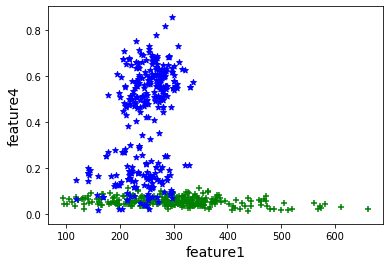
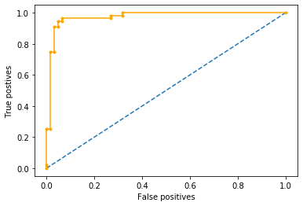

# Results

[← Back to README](../README.md)

## Summary

A linear SVM trained on four hand-crafted features classifies healthy and diseased leaves with **94–97% accuracy** on a held-out 20% test split (119 images).

| Run | Accuracy | Confusion matrix |
|-----|---------:|------------------|
| Saved notebook output | **94.1%** (112 / 119) | `[[54, 2], [5, 58]]` |
| Project report (PDF) | **96.6%** (115 / 119) | `[[62, 0], [4, 53]]` |

The figures differ between runs because the train/test split is random (no `random_state`). Treat the result as **≈ 94–97%**, not as a single exact number.

## Reading the confusion matrix

scikit-learn's `confusion_matrix(y_true, y_pred)` puts the **true** class in rows and the **predicted** class in columns:

```
                 predicted 0   predicted 1
actual 0             TN            FP
actual 1             FN            TP
```

In the notebook run, `[[54, 2], [5, 58]]` means 7 errors in total: 2 class-0 leaves were predicted as class 1, and 5 class-1 leaves were predicted as class 0. Which class is "0" depends on the labelling . In the saved notebook run, `diseased = 0` and `healthy = 1`.

## Feature scatter plot



This plot shows feature 1 (green-pixel measure) against feature 4 (GLCM contrast).

- One class forms a tight band at **low contrast** (feature 4 < 0.15).
- The other class spreads up to **high contrast** (up to about 0.85).

Feature 4 does most of the work in separating the classes. Feature 1 spans a similar range for both classes.

> **Legend note:** the notebook prints *"Healthy with green and diseased with blue"*, but in this saved run the labels were reversed (`diseased = 0`). In this image, **blue ★ = healthy** and **green + = diseased**. The provided `training.csv` confirms the pattern: healthy leaves average a contrast of 0.41 and diseased leaves 0.05.

## ROC curve



The curve rises steeply toward the top-left corner. The classifier reaches about 95% true positives at a false-positive rate under 10%, far above the dashed random-guess diagonal.

## Conclusions (from the project report)

- An SVM is an effective, lightweight classifier for healthy vs. diseased leaves, reaching > 90% accuracy with only four features.
- A wider variety of images would likely improve results further.
- Adding more informative leaf features should help too.
- The pipeline can be extended to tell disease sub-types apart, such as **fungal, bacterial and viral** infections.
